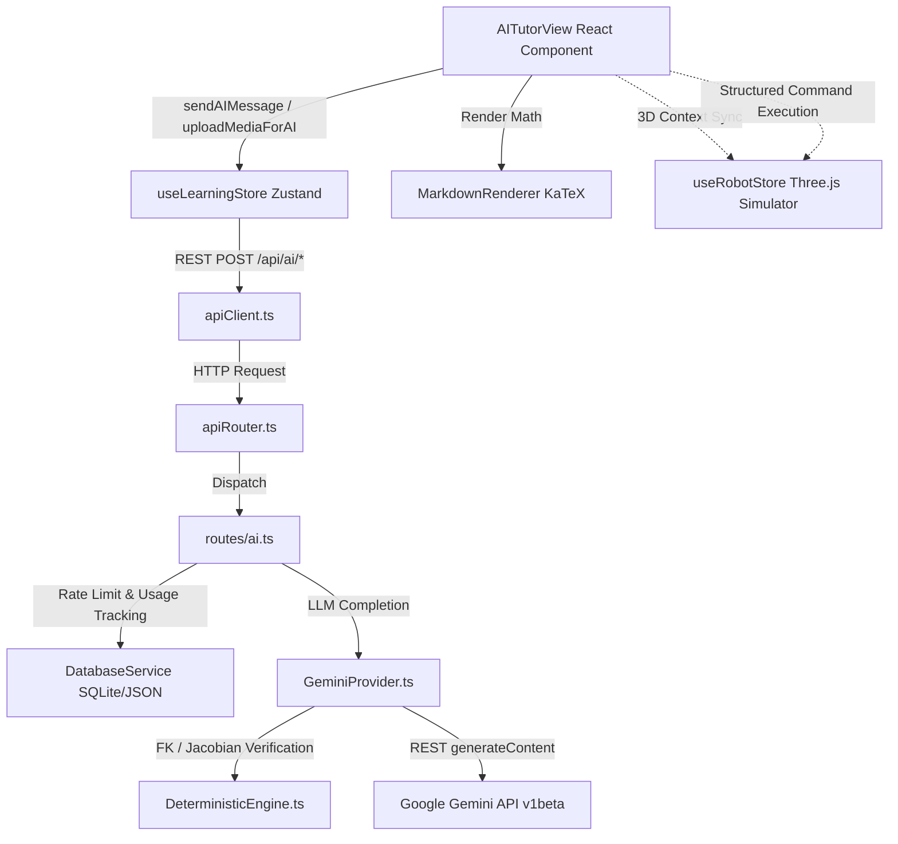

# KyntriX AI Chatbot & Intelligent Tutor Specification

This document preserves the complete technical architecture, data contracts, prompt engineering pipelines, multimodal capabilities, and UI implementations of the **KyntriX AI Robotics Tutor & Assistant** feature.

---

## 1. Executive Summary & Purpose

The KyntriX AI Chatbot was designed as an interactive, pedagogical robotics assistant and real-time simulator controller. Its purpose was to:
1. Provide step-by-step mathematical derivations for robotics kinematics (Denavit-Hartenberg parameters, Forward Kinematics, Inverse Kinematics, Jacobians, and Trajectory Planning).
2. Assist students in solving textbook exercises via text queries or multimodal image/PDF uploads (diagram parsing).
3. Inspect and diagnose mistakes in students' manual calculations (sign reversals, wrong axis conventions, unit mismatches).
4. Read live 3D simulator state (active robot, joint coordinates, manipulability, singularity status) and inject it into the LLM context.
5. Emit structured JSON commands (`set_joints`, `load_robot`, `set_target`) allowing the AI to directly actuate and manipulate the 3D robotics scene.

---

## 2. System Architecture



---

## 3. Data Models and Types (`src/server/ai/types.ts`)

```typescript
export type AIMode =
  | 'tutor'
  | 'solver'
  | 'debugger'
  | 'hints'
  | 'exam'
  | 'simulator_assistant';

export interface AIMessage {
  role: 'user' | 'assistant' | 'system';
  content: string;
}

export interface SimulatorContext {
  robotName?: string;
  dof?: number;
  dhConvention?: 'standard' | 'modified';
  jointTypes?: string[];
  jointValues?: number[];
  jointLimits?: Array<{ min: number; max: number }>;
  targetPose?: {
    position: [number, number, number];
    orientationEuler: [number, number, number];
  };
  currentEndEffectorPose?: {
    position: [number, number, number];
    orientationEuler: [number, number, number];
  };
  isSingular?: boolean;
  manipulability?: number;
  activeTrajectory?: string;
}

export interface AIResponse {
  content: string;
  toolCallsExecuted?: Array<{ name: string; args: any; result: any }>;
  structuredCommand?: {
    action: 'set_joints' | 'load_robot' | 'set_target' | 'apply_dh';
    params: any;
  };
  confidence?: number;
  extractedProblem?: {
    title?: string;
    description?: string;
    knowns?: Record<string, any>;
    requestedOutput?: string;
  };
}

export interface AIProvider {
  name: string;
  generateResponse(
    messages: AIMessage[],
    mode: AIMode,
    context?: SimulatorContext
  ): Promise<AIResponse>;

  analyzeMedia(
    base64Data: string,
    mimeType: string,
    prompt: string,
    mode: AIMode,
    context?: SimulatorContext
  ): Promise<AIResponse>;
}
```

### Database Usage Record (`src/server/db/types.ts`)
```typescript
export interface AIUsageRecord {
  id: string;
  userId: string;
  model: string;
  mode: string;
  requestType: 'chat' | 'image' | 'pdf' | 'tool_call';
  estimatedTokens: number;
  createdAt: string;
}
```

---

## 4. Pedagogy Modes & Prompt Engineering

The system prompt was generated dynamically based on the selected `AIMode` and the optional `SimulatorContext`.

### 4.1 Base System Prompt
```text
You are KyntriX AI, an authoritative, rigorous robotics kinematics and dynamics tutor and engineering simulator assistant.
You adhere strictly to standard robotics engineering principles (John J. Craig, Spong & Vidyasagar, Siciliano).
Guidelines:
1. Accuracy over fluency: Never invent robot kinematic parameters or fake matrix transformations.
2. Step-by-step mathematical derivations: Clearly present transformations, coordinate frames, right-hand rule, and homogeneous matrices.
3. Units & conventions: Always distinguish between Standard DH and Modified (Craig) DH conventions. Distinguish degrees and radians.
4. Format: Use clean markdown, tabular matrices, and clear section headings.
```

### 4.2 Mode-Specific Instructions
| Mode | ID | Description & Instructions |
|---|---|---|
| **Tutor** | `tutor` | "Guide the student through theoretical robotics concepts with clear analogies, geometric intuition, and mathematical derivations." |
| **Problem Solver** | `solver` | "Provide: 1. Problem Interpretation, 2. Known Quantities & Frame Assignments, 3. Governing Equations, 4. Step-by-Step Calculation, 5. Final Verified Result, 6. Physical Interpretation." |
| **Debugger** | `debugger` | "The user will provide their work. Find the EXACT mathematical, sign, frame orientation, or unit mistake. Tell them what went wrong and how to correct it." |
| **Hint Mode** | `hints` | "Progressive hints. Do NOT give away the complete numerical answer. Provide a guiding hint that steers the student to the next conceptual step." |
| **Exam Mode** | `exam` | "Strict assessment conditions (temperature 0.1). Do not reveal solutions. Ask Socratic guiding questions to test student comprehension." |
| **Simulator Assistant** | `simulator_assistant` | "Help the user interact with the 3D KyntriX simulator. When requested to configure a robot, emit a structured command block." |

### 4.3 3D Simulator Context Injection
When `aiContextEnabled` was active in the UI, the current scene state was serialized and appended to the prompt:
```text
Current KyntriX Simulator State:
- Active Robot: Puma 560 (6 DOF)
- DH Convention: Standard
- Current Joint Values (rad): [0, -0.7854, 0.7854, 0, 0, 0]
- Singularity Status: Feasible / Non-singular
- Manipulability (w): 0.1245
- Current End-Effector Position [m]: [0.4521, 0.1204, 0.6318]
- Target Pose Position [m]: [0.5000, 0.1000, 0.6000]
```

---

## 5. Gemini Integration & Model Fallbacks (`src/server/ai/geminiProvider.ts`)

The provider targeted the Google Generative Language REST API (`v1beta/models/{model}:generateContent`) with automatic fallback cascading:

```typescript
private candidateModels = [
  'gemini-3.6-flash',
  'gemini-3.7-flash',
  'gemini-3.5-flash',
  'gemini-flash-latest',
];
```

### 5.1 Deterministic Tool Handoff
Before invoking the LLM, the provider scanned user text for calculation keywords (`fk`, `forward kinematics`, `end-effector position`, `singularity`, `jacobian`). If detected and simulator context was present:
1. It invoked `DeterministicEngine.calculateDHForwardKinematics` or `DeterministicEngine.calculateJacobianForRobot`.
2. It appended the exact mathematical calculation into the context:
   ```text
   [Internal Deterministic Robotics Engine Result]:
   Forward Kinematics: Pos = [0.4521, 0.1204, 0.6318] m, Euler = [0.0000, 0.7854, 0.0000] rad
   Please integrate this verified numerical result into your explanation.
   ```
3. This guaranteed zero numerical hallucination for core calculations.

### 5.2 Offline Fallback Mechanism
If no API key (`GEMINI_API_KEY_2`) was configured, or network/quota failures occurred across all candidate models, the provider fell back to deterministic mathematical templates providing:
- Singularity diagnostics using Yoshikawa manipulability index $w = \sqrt{\det(J J^T)}$.
- Workspace reachability checks ($R_{min} \le r \le R_{max}$).
- Standard Denavit-Hartenberg frame assignment rules ($z_i$ along joint axis, $x_i$ along common normal, link parameters $a_i, \alpha_i, d_i, \theta_i$, and the general $4 \times 4$ homogeneous transformation matrix $A_i$).

---

## 6. Multimodal Vision & Document Processing

Users could upload PNG, JPEG, WEBP images or PDF files (up to 10MB file size, 14MB base64 payload):
1. **Frontend**: Read file via `FileReader`, extracted base64 string, rendered image preview or PDF document chip.
2. **Backend Route** (`/api/ai/upload`): Validated MIME types and size constraints.
3. **Gemini Vision**: Packaged inline base64 data:
   ```json
   {
     "inlineData": {
       "mimeType": "image/png",
       "data": "<base64>"
     }
   }
   ```
   Combined with OCR and diagram extraction prompts:
   `"Analyze this robotics problem image/document, extract the given variables, identify what needs to be solved, and formulate the step-by-step solution."`

---

## 7. Structured Command Protocol

The AI could emit interactive action blocks in standard fenced JSON:
```json
```json
{
  "action": "set_joints",
  "params": {
    "q": [0.0, -0.7854, 1.5708, 0.0, 0.0, 0.0]
  }
}
```
```

### Supported Actions:
- `set_joints`: Actuates the 3D robot arm to joint array `q` (in radians).
- `load_robot`: Swaps the active robot in the 3D scene by `robotId` (e.g. `'Puma560'`, `'ABBIRB120'`).
- `set_target`: Positions the target Cartesian waypoint.

### UI Banner:
When a command was detected, `AITutorView.tsx` rendered an **"AI Simulator Command Ready"** banner with an **"Apply to Robot"** button that executed `setJoints(q)` or `selectRobot(robotId)` via `useRobotStore`.

---

## 8. Backend Endpoints & Rate Limiting (`src/server/routes/ai.ts`)

| Endpoint | Method | Auth Required | Description |
|---|---|---|---|
| `/api/ai/chat` | `POST` | Yes (Bearer token) | Processes chat message history with mode and simulator context. Rate limit: **30 requests / minute / user**. |
| `/api/ai/upload` | `POST` | Yes (Bearer token) | Accepts base64 image or PDF up to 10MB. Returns extraction + derivation. |
| `/api/ai/diagnose` | `POST` | No | Compares student DH table or kinematics against expected data via `DeterministicEngine.diagnoseWork`. |

Token estimations were recorded into `aiUsage` in `kyntrix_db.json` for telemetry and quota tracking.

---

## 9. Frontend Components

### 9.1 `AITutorView.tsx`
- **Layout**: Responsive two-column view (`flex-col lg:flex-row`).
- **Sidebar**:
  - Header with live model status badge (`Gemini Active`).
  - Clear conversation button (`Trash2`).
  - Mode selector pills (Tutor, Solver, Debugger, Hints, Exam, Assistant).
  - 3D Scene context widget (Active Robot, Singularity indicator, Manipulability value, Joint vector in rad) with "Sync with AI" toggle and "Open in 3D Scene" button.
  - Quick Inquiries: 4 pre-filled starter prompts.
- **Chat Container**:
  - Header displaying active mode and badges.
  - Structured command preview chip with "Apply to Robot" action.
  - Message bubble stream with avatars, markdown formatting, attachment badges, and "Copy Derivation" clipboard buttons.
  - Typing indicator during neural generation and diagram OCR.
  - File upload tray with thumbnail preview, file size, and remove button.
  - Input bar with file attachment trigger, text input, and send button.

### 9.2 `MarkdownRenderer.tsx`
Custom renderer supporting:
- Delimiter normalization (`\[ \]` $\to$ `$$ $$`, `\( \)` $\to$ `$ $`).
- Inline and display mathematics using `katex.renderToString`.
- Formatted tables with KaTeX math cells and alternating row styles.
- Syntax-highlighted code blocks with dedicated `Copy` buttons.
- Blockquotes and hierarchical lists.

---

## 10. Re-Integration / Restoration Guide

If this feature is ever reinstated in the future:
1. **Restore Files**:
   - Recreate `src/server/ai/types.ts` and `src/server/ai/geminiProvider.ts`.
   - Recreate `src/server/routes/ai.ts`.
   - Recreate `src/features/learning/AITutorView.tsx` and `src/features/learning/MarkdownRenderer.tsx`.
2. **Re-register Routes**:
   - In `src/server/apiRouter.ts`, import `AIRoutes` and re-add the `/api/ai/chat`, `/api/ai/upload`, and `/api/ai/diagnose` handlers.
3. **Restore Store & Client**:
   - In `src/features/learning/useLearningStore.ts`, re-add `'ai'` to `LearningSubtab`, along with the AI state attributes and actions.
   - In `src/features/learning/apiClient.ts`, re-add `aiChat`, `aiUpload`, and `aiDiagnose`.
4. **Restore Navigation**:
   - In `src/features/learning/LearningWorkspace.tsx`, re-add the AI Tutor tab and render `<AITutorView />`.
   - In `src/features/learning/DashboardView.tsx`, re-add the "Ask AI Tutor" button and sidebar card.
   - In `src/features/learning/ArenaView.tsx`, re-add the "Ask KyntriX AI Tutor" button.
5. **Set Environment Variable**:
   - Supply `GEMINI_API_KEY_2=<your-google-ai-studio-key>` in `.env`.
